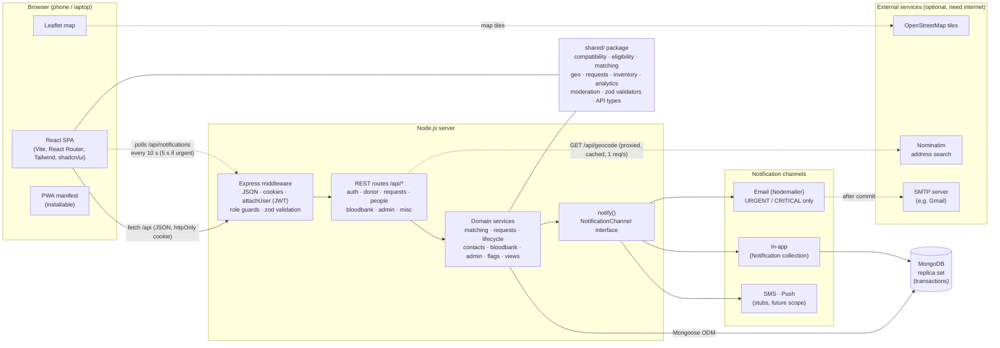
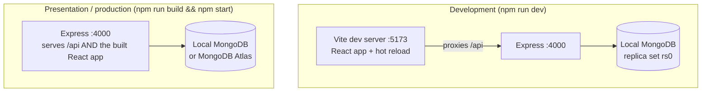

# System Architecture

Red Link is a **three-tier MERN application** written in TypeScript: a React single-page app, an Express REST API, and a MongoDB database. The rules that decide who can donate to whom live in a **shared package** used by both the browser and the server, so the same rules apply on both sides.

## 1. Architecture diagram

Solid lines are always used. Dotted lines are periodic or optional: polling, and the external services that need internet. The app still works if those fail. The map shows a notice and keeps working without tiles, and "Use my location" or clicking the map replaces address search.

## 2. Layers

| Layer | Folder | Responsibility |
|---|---|---|
| **Presentation** | `client/src/pages`, `client/src/components` | Role-specific pages (spec Section 8), forms (react-hook-form + zod), maps, charts, notification bell and urgent banner. Route guards send users to their own dashboard. |
| **API** | `server/src/routes` | 45 REST endpoints under `/api` plus `/api/health`. Every handler validates input with a shared zod schema, checks the session and role, and returns `{ error }` with the right status code on failure. |
| **Domain services** | `server/src/services` | The business processes: broadcasting and matching, accepting and recording donations, lifecycle (cancel, expire, escalate), contact requests, blood bank supply, admin moderation and reports. |
| **Domain rules** | `shared/src/domain` | Pure functions with no database: compatibility, eligibility, Haversine distance and bounding box, scoring, status transitions, inventory, analytics, moderation. Covered by 187 unit tests. |
| **Data** | `server/src/models.ts` | Ten Mongoose models (see [ER_DIAGRAM.md](ER_DIAGRAM.md)). `DonorProfile` and `Institution` are embedded in `User`. |
| **Notifications** | `server/src/notify.ts` | `notify(userIds, payload)` writes in-app notifications and calls every registered `NotificationChannel`. |

## 3. Key design decisions

### 3.1 One set of rules, two places

The `shared/` workspace is imported by both the server and the React client.

- **Matching** and **eligibility** run on the server. The client uses the same eligibility function to show "You can donate again on 12 Jan 2027".
- **Validation:** the same zod schema checks a form in the browser and the request body on the server.
- **API response types** (`shared/src/api.ts`) are used to type both the server's functions and the client's fetch calls. If the two drift apart, `npm run build` fails before anything ships.

### 3.2 Transactions and conditional updates

Many actions touch several documents at once. Recording a donation, for example:

- creates the donation record;
- marks the match as donated;
- updates the donor's last donation date and verified badge;
- adds units to the request;
- notifies the people involved.

Every action like this runs inside a **MongoDB transaction** (`server/src/db.ts`), so it either completes fully or not at all. That is why MongoDB runs as a **replica set**, even a single-node one, since transactions require it.

State changes also use **conditional updates**, for example "set FULFILLED only if still OPEN with the units I read". When two staff click at the same moment, or two notification polls try to expire the same request, only one succeeds. The acceptance tests check this by firing simultaneous requests.

### 3.3 Side effects after commit

Emails are queued on the transaction context and sent **only after the transaction commits**. A rolled-back action never sends an email.

### 3.4 Lazy background work

CRITICAL auto-escalation (after 10 minutes) and expiry (after the needed-by time) don't need a separate job scheduler. They run **lazily** whenever someone polls notifications or opens a request, dashboard or feed. Since every logged-in user polls every 10 seconds, this happens often enough. Conditional updates make it safe to run many times at once.

### 3.5 Privacy by design

- The server never sends donor coordinates.
  - Distances are rounded to 0.5 km.
  - Search-map pins are snapped to a ~1 km grid.
  - Names are masked ("Rahul S.").
- A phone number is sent to a requester's browser only for donors who **accepted** that request, or for a contact request the donor **accepted**.
- The session is a signed JWT in an **httpOnly** cookie, which JavaScript in the page cannot read.

## 4. Deployment views

For the presentation, one command serves everything from one port, and it works with no internet connection. For a public URL, the same build runs on Render with a MongoDB Atlas database (see README, "Deploying online", and `render.yaml`).

## 5. Request flow example: accepting a request

1. The donor taps **Accept**. The browser sends `POST /api/matches/:id/respond` `{ action: "ACCEPT" }` with the session cookie.
2. `attachUser` verifies the JWT and loads the user **fresh from the database**, so a suspension takes effect immediately. `requireUser(["DONOR"])` checks the role.
3. The handler validates the body with `respondSchema` (zod) and calls `respondToMatch()`.
4. In a transaction, the service:
   - loads the match, request and donor;
   - checks the transition with `nextMatchStatus()` and eligibility with `isEligible()`, both from `shared/`;
   - updates the match **only if its status hasn't changed**;
   - notifies the requester and the chosen hospital.
5. The response `{ status: "ACCEPTED" }` returns. The hospital's request page picks up the change on its next 10-second refresh and shows the donor's name and phone number.
