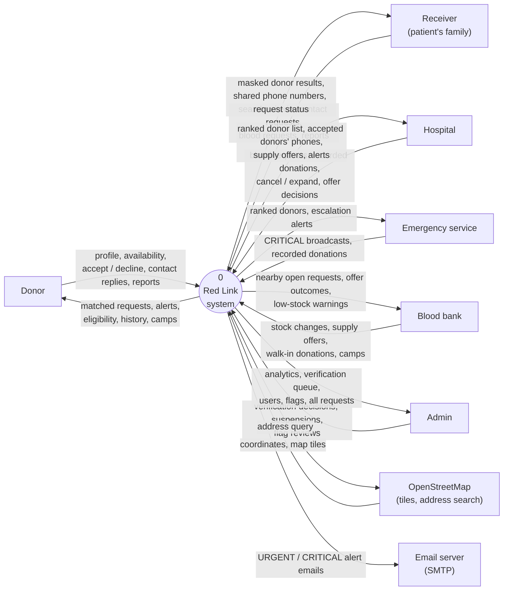
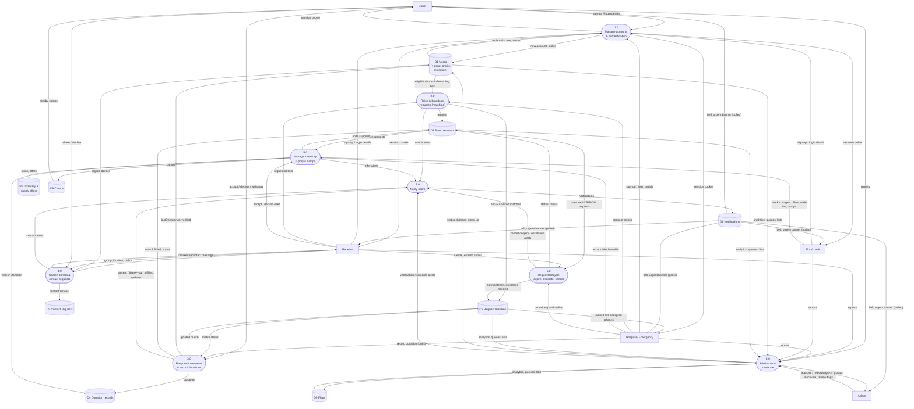

# Data Flow Diagrams

Notation: rectangles are **external entities**, rounded boxes are **processes**, and cylinders are **data stores** (MongoDB collections). Arrow labels name the data that flows.

## Level 0: Context diagram

The whole system is one process. It exchanges data with six user roles and three optional external services.

## Level 1: Main processes

## Process descriptions

| No. | Process | Input | Output | Data stores |
|---|---|---|---|---|
| 1.0 | Manage accounts & authentication | Sign-up form (with map location), login | Session cookie (JWT), account status | D1 |
| 2.0 | Raise & broadcast requests | Blood group, units, urgency, needed-by, hospital, location | Ranked matches (≤ 50), donor alerts | D1, D2, D3 |
| 3.0 | Respond & record donations | Accept / decline / withdraw; record donation (1–2 units) | Updated match, donation record, verified badge, cooldown, fulfilled units | D1–D4 |
| 4.0 | Search & contact | Patient's group, location, radius, verified-only; contact message | Masked results (name initial, ~distance, ~1 km map pin); phones after acceptance | D1, D5 |
| 5.0 | Inventory, supply & camps | Stock changes, offers, walk-ins, camps | Stock levels, offers, units supplied, camp listings | D2, D4, D7, D8 |
| 6.0 | Request lifecycle | Time passing (checked lazily), cancel, expand | Expired / cancelled requests, widened radius, new matches | D2, D3 |
| 7.0 | Notify users | Events from processes 2.0–8.0 | In-app notifications; email for URGENT / CRITICAL | D6 |
| 8.0 | Administer & moderate | Verification decisions, suspensions, flag reviews, reports | Status changes and clean-up, analytics | D1, D2, D3, D9 |
