# Entity–Relationship Diagram

Generated from the Mongoose models in [`server/src/models.ts`](../server/src/models.ts). MongoDB stores documents, but the model is relational in shape. Every reference below is an `ObjectId` pointing to another collection.

- `DonorProfile` and `Institution` are **embedded** inside `User`. They are one-to-one and always read together with the user, so they are not separate collections. They are drawn as their own entities to keep the diagram clear.
- Allowed values for enum-like fields (status, role, urgency…) are listed in [`shared/src/domain/constants.ts`](../shared/src/domain/constants.ts). Mongoose enforces them with `enum` validation.

```mermaid
erDiagram
  USER ||--o| DONOR_PROFILE : "embeds (donors)"
  USER ||--o| INSTITUTION : "embeds (hospital / emergency / blood bank)"
  USER ||--o{ BLOOD_REQUEST : "creates"
  USER |o--o{ BLOOD_REQUEST : "records donations for (chosen hospital)"
  BLOOD_REQUEST ||--o{ REQUEST_MATCH : "is matched to donors via"
  USER ||--o{ REQUEST_MATCH : "is alerted as donor"
  USER ||--o{ DONATION_RECORD : "donates"
  USER ||--o{ DONATION_RECORD : "records (institution)"
  BLOOD_REQUEST |o--o{ DONATION_RECORD : "is fulfilled by"
  USER ||--o{ CONTACT_REQUEST : "sends (receiver)"
  USER ||--o{ CONTACT_REQUEST : "receives (donor)"
  USER ||--o{ NOTIFICATION : "receives"
  USER ||--o{ INVENTORY_ITEM : "stocks (blood bank)"
  USER ||--o{ SUPPLY_OFFER : "offers (blood bank)"
  BLOOD_REQUEST ||--o{ SUPPLY_OFFER : "receives"
  USER ||--o{ DONATION_CAMP : "organises (blood bank)"
  USER ||--o{ FLAG : "reports"
  USER |o--o{ FLAG : "is reported in"
  BLOOD_REQUEST |o--o{ FLAG : "is reported in"

  USER {
    ObjectId _id PK
    string role "DONOR | RECEIVER | HOSPITAL | EMERGENCY | BLOOD_BANK | ADMIN"
    string status "PENDING_VERIFICATION | ACTIVE | SUSPENDED | REJECTED"
    string name
    string email UK
    string phone "10-digit Indian mobile"
    string passwordHash "bcrypt"
    number lat "nullable"
    number lng "nullable"
    string address
    string city
    string pincode
    date createdAt
  }
  DONOR_PROFILE {
    string bloodGroup "O- O+ A- A+ B- B+ AB- AB+"
    date dateOfBirth
    string gender "MALE | FEMALE | OTHER"
    number weightKg
    date lastDonationAt "nullable"
    boolean isAvailable
    boolean bloodGroupVerified
  }
  INSTITUTION {
    string type "HOSPITAL | EMERGENCY | BLOOD_BANK"
    string orgName
    string licenseNumber
    date verifiedAt "nullable"
    ObjectId verifiedById FK "admin"
    string rejectionNote "nullable"
  }
  BLOOD_REQUEST {
    ObjectId _id PK
    ObjectId createdById FK
    ObjectId recordingHospitalId FK "nullable; receiver requests"
    string bloodGroup
    number unitsNeeded "1-20"
    number unitsFulfilled
    string urgency "NORMAL | URGENT | CRITICAL"
    string status "OPEN | PARTIALLY_FULFILLED | FULFILLED | CANCELLED | EXPIRED"
    string patientNote "nullable"
    string hospitalName
    string hospitalAddress
    number lat
    number lng
    number radiusKm
    date neededBy
    date createdAt
    date fulfilledAt "nullable"
    date lastEscalatedAt "nullable"
  }
  REQUEST_MATCH {
    ObjectId _id PK
    ObjectId requestId FK "unique with donorId"
    ObjectId donorId FK
    number distanceKm
    number score "0-100"
    string status "NOTIFIED | ACCEPTED | DECLINED | DONATED | NO_LONGER_NEEDED"
    date notifiedAt
    date respondedAt "nullable"
  }
  DONATION_RECORD {
    ObjectId _id PK
    ObjectId donorId FK
    ObjectId requestId FK "nullable; null = walk-in"
    ObjectId recordedById FK
    number units "1-2"
    date donatedAt
    string location
  }
  CONTACT_REQUEST {
    ObjectId _id PK
    ObjectId receiverId FK
    ObjectId donorId FK
    string message "5-300 chars"
    string status "PENDING | ACCEPTED | DECLINED"
    date createdAt
    date respondedAt "nullable"
  }
  NOTIFICATION {
    ObjectId _id PK
    ObjectId userId FK
    string type "REQUEST_MATCH | REQUEST_UPDATE | CONTACT_REQUEST | CONTACT_RESPONSE | VERIFICATION | SUPPLY_OFFER | SYSTEM"
    string priority "NORMAL | URGENT | CRITICAL"
    string title
    string body
    string link "nullable"
    date readAt "nullable"
    date createdAt
  }
  INVENTORY_ITEM {
    ObjectId _id PK
    ObjectId bloodBankId FK "unique with bloodGroup"
    string bloodGroup
    number units "never below 0"
    number lowStockThreshold "default 5"
    date updatedAt
  }
  SUPPLY_OFFER {
    ObjectId _id PK
    ObjectId requestId FK
    ObjectId bloodBankId FK
    string bloodGroup "any compatible group"
    number units
    string status "PENDING | ACCEPTED | DECLINED"
    date createdAt
  }
  DONATION_CAMP {
    ObjectId _id PK
    ObjectId bloodBankId FK
    string title
    string description
    date startsAt
    date endsAt
    string address
    number lat
    number lng
  }
  FLAG {
    ObjectId _id PK
    ObjectId reporterId FK
    ObjectId targetUserId FK "nullable"
    ObjectId requestId FK "nullable"
    string reason "10-500 chars"
    string status "OPEN | RESOLVED | DISMISSED"
    date createdAt
    date resolvedAt "nullable"
    ObjectId resolvedById FK "nullable; admin"
    string resolutionNote "nullable"
  }
```

## Indexes

| Collection | Index | Purpose |
|---|---|---|
| users | `email` (unique) | Login, one account per email |
| users | `{ role, status, lat, lng }` | Matching prefilter: active donors inside the bounding box (spec 5.6) |
| users | `phone` | Walk-in donor lookup, admin search |
| bloodrequests | `status`, `createdById`, `recordingHospitalId` | Dashboards, lazy expiry / escalation |
| requestmatches | `{ requestId, donorId }` (unique) | A donor is matched to a request at most once, even under concurrency |
| requestmatches | `donorId` | Donor feed |
| notifications | `{ userId, readAt, createdAt }` | Bell polling (unread count + latest) |
| inventoryitems | `{ bloodBankId, bloodGroup }` (unique) | One stock row per group per bank |
| supplyoffers | `requestId` | Offers on a request page |
| flags | `{ status, createdAt }`, `{ targetUserId, status }` | Flags page tabs; open-flag counts on the Users page |

## Changes to the spec's schema

Field names follow spec Section 6. These additions were agreed during the build (see [DECISIONS.md](DECISIONS.md)):

- `BloodRequest.hospitalAddress`: so donors know where to go.
- `BloodRequest.recordingHospitalId`: for receiver-raised requests, the verified hospital that records the donations.
- `SupplyOffer.bloodGroup`: a blood bank can offer any compatible group.
- `Flag.resolvedAt`, `resolvedById`, `resolutionNote`: the admin's review of a report.
