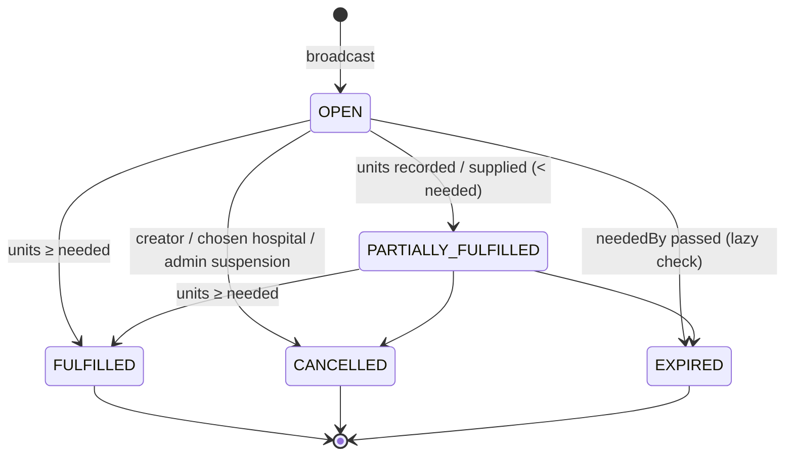

# Matching Algorithm

All rules here are pure TypeScript functions in [`shared/src/domain`](../shared/src/domain) with unit tests in [`shared/tests`](../shared/tests). The constants (radii, scores, limits) are in `constants.ts`, so a rule can be changed in one place.

## 1. Blood-group compatibility (red cells)

Who a **recipient** can receive red cells from (spec 5.2). `compatibleDonorGroups(recipient)` and `canDonateTo(donor, recipient)` implement this table. The tests cover all 64 donor/recipient pairs.

| Recipient ↓ / Donor → | O− | O+ | A− | A+ | B− | B+ | AB− | AB+ |
|---|:-:|:-:|:-:|:-:|:-:|:-:|:-:|:-:|
| **O−** | ✅ | | | | | | | |
| **O+** | ✅ | ✅ | | | | | | |
| **A−** | ✅ | | ✅ | | | | | |
| **A+** | ✅ | ✅ | ✅ | ✅ | | | | |
| **B−** | ✅ | | | | ✅ | | | |
| **B+** | ✅ | ✅ | | | ✅ | ✅ | | |
| **AB−** | ✅ | | ✅ | | ✅ | | ✅ | |
| **AB+** | ✅ | ✅ | ✅ | ✅ | ✅ | ✅ | ✅ | ✅ |

O− is the universal donor (its column is all ✅). AB+ is the universal recipient (its row is all ✅).

## 2. Donor eligibility: `isEligible(donor, now)`

A donor is eligible only if **every** rule passes (spec 5.3):

| Rule | Value | Notes |
|---|---|---|
| Account status | `ACTIVE` | Suspended or pending accounts are never matched |
| Availability | `isAvailable === true` | The donor's own toggle |
| Age | 18–65 years, inclusive | Whole years from date of birth (birthday not yet reached this year counts one less) |
| Weight | ≥ 50 kg | |
| Rest period | `lastDonationAt` is null **or** ≥ 90 days ago | `DONATION_COOLDOWN_DAYS = 90`, measured to the millisecond |

The function returns `eligible`, every failing `reason`, and `nextEligibleDate` (last donation + 90 days). The donor's home page uses it to show messages such as *"You can donate again on 12 Jan 2027"*. The same function runs in the browser and on the server.

**Example.** A donor last donated on 1 Oct 2026. Their `nextEligibleDate` is 30 Dec 2026. They are not eligible on 29 Dec, and eligible again from 30 Dec at the same time of day.

## 3. Search radius by urgency

| Urgency | Starting radius | Escalation |
|---|---|---|
| NORMAL | 10 km | none |
| URGENT | 25 km | Manual "Expand radius": +25 km per click, up to 75 km |
| CRITICAL | 50 km | **Automatic, once:** if fewer than 3 donors have accepted (or donated) 10 minutes after creation, the radius becomes 100 km and newly reached donors are alerted |

Escalation is checked **lazily** whenever anyone polls notifications or opens a request, dashboard or feed. A conditional update ("only if `lastEscalatedAt` is still null") guarantees it happens exactly once, even when many polls arrive together.

## 4. Distance

**Haversine** great-circle distance with Earth radius R = 6371 km:

```
a = sin²(Δlat / 2) + cos(lat₁) · cos(lat₂) · sin²(Δlng / 2)
d = 2R · asin(√a)
```

The unit tests check a known distance: CSMT → Ghatkopar station is about 18.0 km in a straight line. The spec's estimate of 12–13 km was corrected; see `DECISIONS.md` C1.

**Bounding-box prefilter.** Running Haversine on every donor would be wasteful. The database query first selects only donors inside a lat/lng box that fully contains the search circle:

```
Δlat = r / 111.19 km           (km per degree of latitude)
Δlng = r / (111.19 km · cos(lat))
r    = radius × 1.01           (1% margin so float error never drops a donor at the edge)
```

That query uses the index `{ role, status, lat, lng }`. Haversine then removes the box's corners, which lie outside the circle. [NON_FUNCTIONAL.md](NON_FUNCTIONAL.md) gives the measured speed-up.

## 5. Scoring: `scoreDonor()`

Each candidate gets a score from 0 to 100 (spec 5.5):

| Part | Points | Why |
|---|---|---|
| Exact blood group match | **+30** | Keeps universal donors (O−) free for patients who can only receive O− |
| Proximity | **+50 × (1 − distance / radius)** | A donor at the hospital gets 50, a donor at the edge of the radius gets 0 |
| Blood group verified | **+20** | The group was confirmed at a recorded donation |

Donors are sorted by score, highest first. Ties go to the nearer donor, then to the donor id, so the order is stable. At most **50** donors are notified per request or escalation step.

## 6. Worked example (from the demo data)

The seeded open request: **B+ patient, URGENT, radius 25 km, at Vidyavihar General Hospital**. Five of the donors it found:

| Donor (as shown) | Group | Distance | Exact group | Proximity = 50 × (1 − d/25) | Verified | **Score** |
|---|---|---|---|---|---|---|
| Divya C. | B+ | 5 km | +30 | 50 × 0.80 = 40 | +20 | **90** |
| Aisha K. | B+ | 6 km | +30 | 50 × 0.76 = 38 | +20 | **88** |
| Siddharth J. | B+ | 8 km | +30 | 50 × 0.68 = 34 | — | **64** |
| Ananya I. | O+ | 4.5 km | — | 50 × 0.82 = 41 | +20 | **61** |
| Aarav M. | O− | < 0.5 km | — | ≈ 49.6 (for ~0.2 km) | — | **50** (rounded) |

Two things to notice:

- **Aarav (O−) lives closest, yet ranks below every B+ donor.** The +30 for an exact group match saves the universal O− donor for patients who need O−, as the spec intends.
- **Verification counts.** Ananya (O+, verified, 4.5 km) outranks Aarav (O−, unverified, under 0.5 km).

The distances are the rounded values shown to users. The server scores with the exact distance, so the real scores can differ by a point.

## 7. Pseudocode

```text
function BROADCAST(request):                         // createRequest() + matchAndNotify()
    radius ← INITIAL_RADIUS[request.urgency]           // 10 / 25 / 50 km
    BEGIN TRANSACTION
        save request
        matches ← FIND_MATCHES(request, radius, alreadyMatched = ∅)
        for m in matches: save RequestMatch(request, m.donor, m.distance, m.score, NOTIFIED)
        notify(matches.donors, priority = request.urgency)
    COMMIT
    after commit: email URGENT / CRITICAL alerts (if configured)

function FIND_MATCHES(request, radius, alreadyMatched):
    groups ← COMPATIBLE_DONOR_GROUPS(request.bloodGroup)
    box ← BOUNDING_BOX(request.location, radius)
    candidates ← DB: users where role = DONOR, status = ACTIVE, isAvailable,
                      bloodGroup ∈ groups, lat/lng inside box
    results ← []
    for d in candidates:
        if d.id = request.createdBy or d.id ∈ alreadyMatched: continue
        if not IS_ELIGIBLE(d, now): continue                // age, weight, 90-day rest
        dist ← HAVERSINE(request.location, d.location)
        if dist > radius: continue                            // outside the circle (box corner)
        score ← (d.group = request.group ? 30 : 0)
              + 50 × (1 − dist / radius)
              + (d.verified ? 20 : 0)
        results.append(d, dist, score)
    sort results by score desc, then dist asc, then id asc
    return first 50 of results

function LAZY_MAINTENANCE(now):                      // on every notifications poll / page view
    for r in active requests with neededBy < now:
        conditionally set r.status ← EXPIRED; tell waiting donors "no longer needed"
    for r in CRITICAL active requests created ≥ 10 min ago with lastEscalatedAt = null:
        if count(matches ACCEPTED or DONATED) < 3:
            conditionally set radius ← 100, lastEscalatedAt ← now   // only one caller wins
            FIND_MATCHES(r, 100, alreadyMatched = existing matches) → save + notify
```

## 8. After matching: request lifecycle



When a request reaches FULFILLED, CANCELLED or EXPIRED:

- every donor still NOTIFIED or ACCEPTED becomes NO_LONGER_NEEDED and gets a "No longer needed, thank you!" message;
- pending blood bank offers are declined, and the banks are told.

A donor's match moves from NOTIFIED to ACCEPTED or DECLINED. A donor can change their mind until the donation is recorded. The match then becomes DONATED, or NO_LONGER_NEEDED if the request closes first.
