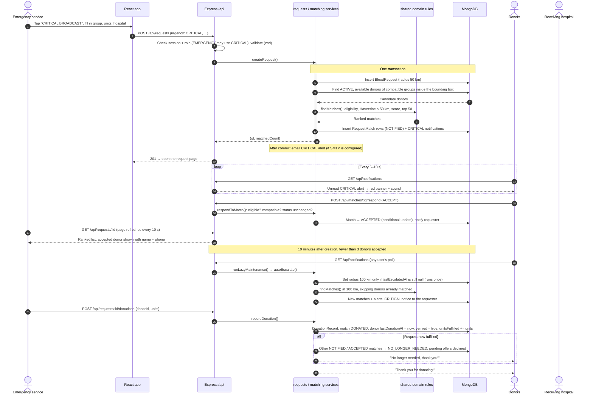
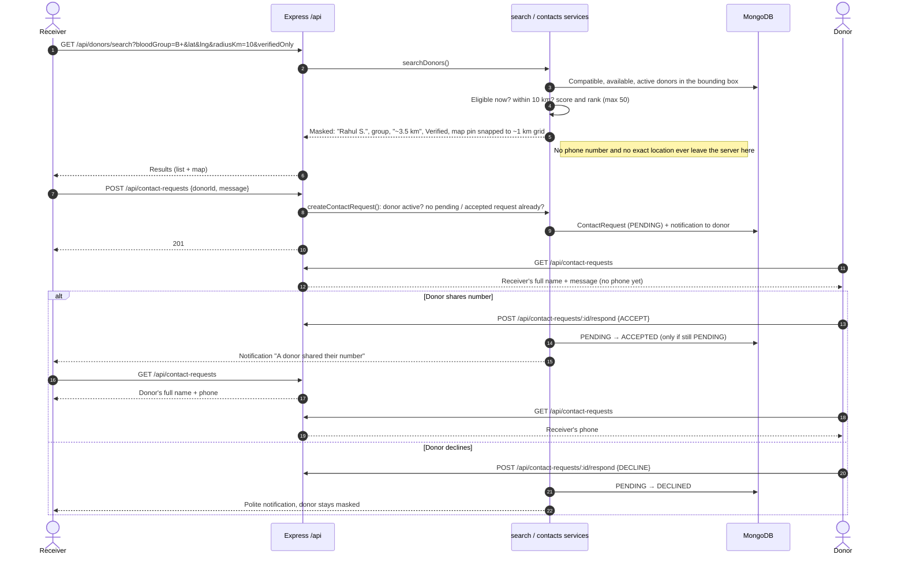
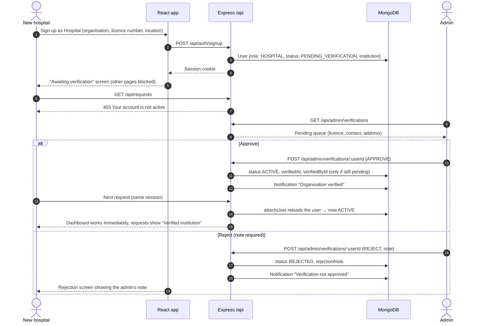

# Sequence Diagrams

The three key flows from spec Section 16. Participant names match the code: `api` routes in `server/src/routes`, services in `server/src/services`, and domain rules in `shared/src/domain`.

## 1. Emergency broadcast (CRITICAL), with automatic escalation

## 2. Contact request (receiver ↔ donor)

## 3. Institution verification

