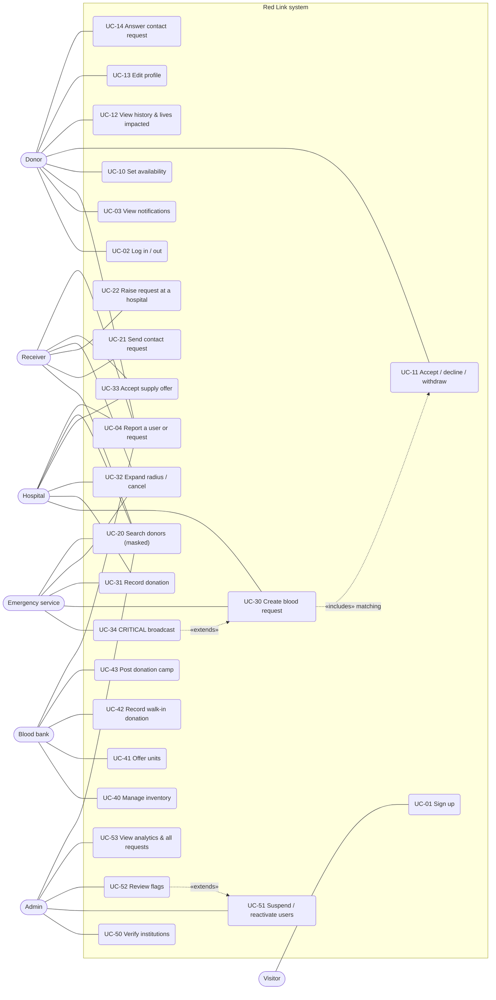

# Use Cases

## Use-case diagram

Mermaid has no UML use-case diagram type, so this uses a flowchart: actors on the outside, use cases (rounded) inside the system boundary. Every actor except a visitor first logs in (UC-01, UC-02).

## Common use cases (all roles)

| ID | Use case | Main flow | Result |
|---|---|---|---|
| UC-01 | Sign up | Pick a role → fill in the form → set location (GPS, map click or address search) → submit | Donor / receiver: active straight away. Hospital, emergency, blood bank: **pending verification**, see an "Awaiting verification" screen. |
| UC-02 | Log in / out | Email + password → sent to the role's dashboard | 7-day httpOnly session cookie. Suspended accounts are refused; 10 wrong passwords in 15 min locks that email for a while. |
| UC-03 | View notifications | Bell shows unread count (polled every 10 s); urgent ones show a red banner and play a short sound | Mark one / all as read |
| UC-04 | Report a user or request | **Report** on a request page, an accepted donor, or a contact request → describe the problem (10–500 chars) | Flag created for the admin; reporter later told the outcome |

## Donor

| ID | Use case | Precondition | Main flow | Result |
|---|---|---|---|---|
| UC-10 | Set availability | Logged in | Toggle "Available to donate" | Unavailable donors aren't matched or shown in searches |
| UC-11 | Accept / decline / withdraw | Alerted for an open request | Open request → see group, units, hospital, distance, urgency, compatibility note → Accept or Decline. After accepting: see hospital address; may withdraw until the donation is recorded | Requester notified on accept / withdraw. Ineligible donors can't accept (reason shown). |
| UC-12 | View history | — | Open History | Donations list, total units, lives impacted (units × 3), next eligible date |
| UC-13 | Edit profile | — | Change any field, including location and blood group | Changing blood group removes the Verified badge and withdraws from incompatible requests |
| UC-14 | Answer contact request | A receiver asked for their number | Read name + message → Share my number / Decline | Accept: both see each other's phone. Decline: receiver told politely. |

## Receiver (patient's family)

| ID | Use case | Precondition | Main flow | Result |
|---|---|---|---|---|
| UC-20 | Search donors | Logged in | Choose patient's group, radius (5/10/25/50 km), optionally "verified only" → list or map | Masked results (e.g. "Rahul S. · O+ · ~3.5 km · Verified"), map pins on a ~1 km grid. Only donors who can donate now. |
| UC-21 | Send contact request | Search results shown | Request contact → short message | Donor notified. One pending request per donor at a time. |
| UC-22 | Raise a request | — | Choose group, units, NORMAL / URGENT, needed-by, and the **verified hospital** where the patient is admitted | Broadcast to compatible donors near that hospital; the hospital records donations |
| UC-32 | Expand radius / cancel | Own open request | URGENT: Expand (+25 km, up to 75 km). Cancel with an optional reason | More donors alerted / donors told it's no longer needed |
| UC-33 | Accept a supply offer | A blood bank offered units | Accept / Decline | Bank stock goes down; request units go up |

## Hospital

| ID | Use case | Precondition | Main flow | Result |
|---|---|---|---|---|
| UC-30 | Create blood request | Verified | Group, units (1–20), urgency (NORMAL / URGENT), needed-by, note; location defaults to the hospital | Top 50 ranked compatible, eligible donors in range are alerted |
| UC-31 | Record donation | A donor accepted | On the request page: Record donation → 1 or 2 units | Donation saved; donor verified and starts 90-day rest; units added; fulfilled → others told "no longer needed" |
| UC-32 | Expand radius / cancel | Own open request (or chosen hospital for cancel) | As above | As above |
| UC-33 | Accept supply offer | Own request or chosen hospital | As above | As above |
| — | View patient requests | A receiver chose this hospital | Dashboard → "Patient requests at your hospital" | Can record donations and answer offers for them |

## Emergency service

| ID | Use case | Precondition | Main flow | Result |
|---|---|---|---|---|
| UC-34 | CRITICAL broadcast | Verified | Big red **CRITICAL BROADCAST** button → form pre-filled with CRITICAL | 50 km radius. If fewer than 3 donors accept within 10 minutes, the search widens once to 100 km automatically and more donors are alerted. |
| UC-30/31 | Create request, record donations | Verified | As for hospitals (records donations on its own requests) | As above |

## Blood bank

| ID | Use case | Precondition | Main flow | Result |
|---|---|---|---|---|
| UC-40 | Manage inventory | Verified | 8-tile grid: −1 / +1 / +5, or set exact units and low-stock threshold | Low stock (≤ threshold) shown in red; never below 0 |
| UC-41 | Offer units | An open request within 50 km where the bank has compatible stock | Choose group and units → Offer | Requester notified. Stock is taken only when accepted. |
| UC-42 | Record walk-in | Donor is eligible | Find donor by email / phone → record 1–2 units | Donation saved, donor verified, stock increased for the donor's group |
| UC-43 | Post camp | Verified | Title, description, dates, location | Shown on nearby donors' home pages (within 25 km) |

## Admin

| ID | Use case | Precondition | Main flow | Result |
|---|---|---|---|---|
| UC-50 | Verify institutions | Pending application | Check licence → Approve, or Reject with a note | Approved: active. Rejected: sees the note. Applicant notified either way. |
| UC-51 | Suspend / reactivate | Active (or suspended) non-admin account | Users → search → Suspend (explains clean-up) / Reactivate | Suspended at once (also existing sessions). Their open requests cancelled / matches withdrawn / offers withdrawn / camps hidden, with notifications. |
| UC-52 | Review flags | Open report | Resolve, Dismiss, or Suspend user & resolve, with an optional note | Reporter told the outcome |
| UC-53 | Analytics & all requests | — | Dashboard: totals, fulfilment rate, average time to first acceptance, two charts. Requests: read-only list and detail with accepted donors' phones | — |
